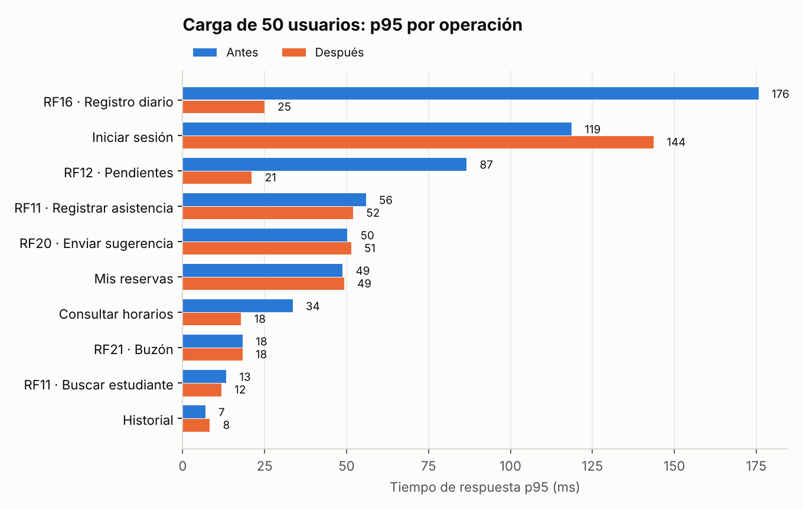
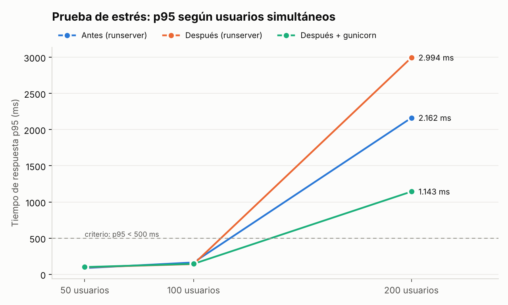

# Informe de pruebas de seguridad y rendimiento

**Sistema:** Reservas del gimnasio UdeM. **Alcance:** API de Django y frontend React, con énfasis en RF11, RF12, RF13, RF16, RF20 y RF21.
**Fecha de ejecución:** 11 y 12 de octubre de 2026.
**Herramientas:** Cypress 13 (pruebas de seguridad), k6 0.54 (carga y estrés), revisión de configuración.

Cada prueba documenta su objetivo, el resultado esperado, el resultado obtenido y la evidencia de ejecución. El detalle prueba por prueba está en [`cypress/MATRIZ_DE_PRUEBAS.md`](cypress/MATRIZ_DE_PRUEBAS.md), en la sección *Seguridad*.

---

## 1. Resumen

| | Antes | Después |
|---|---|---|
| Controles de seguridad verificados (deben pasar) | 8 de 8 ✅ | 8 de 8 ✅ |
| Vulnerabilidades confirmadas (OWASP Top 10) | 11 | **4 pendientes**; las 4 requieren autenticación (§2.4) |
| Errores bajo carga (50 y 200 usuarios) | 0 % | 0 % |
| p95 con 50 usuarios (criterio < 500 ms) | 91 ms ✅ | 103 ms ✅ |
| p95 de RF16 · registro diario, con 50 usuarios | 176 ms | **25 ms** (7× más rápido) |
| p95 de RF12 · pendientes, con 50 usuarios | 87 ms | **21 ms** (4× más rápido) |
| p95 con 200 usuarios (estrés) | 1,25 s ❌ | **0,70 s** con gunicorn (−44 %); máximo de 8,1 s a 2,5 s |
| Capacidad que cumple el criterio p95 < 500 ms | hasta 100 usuarios simultáneos | hasta 100 usuarios simultáneos; con 200 ninguna configuración cumple, pero gunicorn reduce el p95 a menos de la mitad |

**Conclusión.** El sistema cumple los criterios de rendimiento con la carga esperada: el gimnasio tiene 120 cupos al día y 50 usuarios simultáneos ya es un pico alto. Con 200 usuarios el servidor se satura. El cuello de botella no es la lógica de RF11–RF21 sino el servidor de desarrollo de Django y el costo del hash de contraseñas, y cambiar a gunicorn reduce la degradación a la mitad.

En seguridad se corrigieron 7 de las 11 vulnerabilidades. Las 4 restantes tienen una sola causa: **la API no autentica**. Quien conozca el correo de otra persona puede actuar en su nombre. Es la mejora prioritaria (§2.4).

---

## 2. Pruebas de seguridad

### 2.1 Método

- **Pruebas automatizadas con Cypress** (`cypress/e2e/seguridad/`), organizadas según **OWASP Top 10 (2021)**:
  - `controles.cy.js` contiene los controles que el sistema sí tiene. Deben pasar siempre: si uno falla, se perdió un control.
  - `vulnerabilidades.cy.js` afirma el comportamiento **seguro**. Mientras la vulnerabilidad exista, la prueba falla y su error es la evidencia. Al corregirla pasa a verde y queda como prueba de regresión de seguridad.
- **Revisión de configuración** de `settings.py`, el Dockerfile, nginx y los endpoints.
- Ambos archivos se ejecutaron **antes** de corregir (`cypress/reports/antes/`) y **después** (`cypress/reports/`).

Ejecutar: `cd frontend && npm run cy:seguridad && npm run cy:vulnerabilidades`.

### 2.2 Controles que el sistema implementa (8 de 8 pasan)

| ID | OWASP | Control verificado | Resultado |
|---|---|---|---|
| SEG-01 | A02 Fallas criptográficas | Contraseñas con PBKDF2-SHA256, 100 000 iteraciones y sal propia; nunca en claro | ✅ |
| SEG-02 | A07 Autenticación | El login responde lo mismo para un correo existente y uno inexistente (no permite enumerar usuarios) | ✅ |
| SEG-03 | A07 Autenticación | Una cuenta desactivada no inicia sesión (403) | ✅ |
| SEG-04 | A01 Control de acceso | Solo se aceptan correos institucionales | ✅ |
| SEG-05 | A04 Diseño inseguro | El rol no se puede elegir al registrarse (asignación masiva bloqueada): sale del dominio del correo | ✅ |
| SEG-06 | A01 Control de acceso | Cinco acciones de entrenador o administrador rechazan a un estudiante (403) | ✅ |
| SEG-07 | A03 Inyección (XSS) | Un mensaje con `<script>` e `` se muestra como texto en el buzón y no se ejecuta | ✅ |
| SEG-08 | A04 Diseño inseguro | Tres registros simultáneos de la misma asistencia: exactamente uno tiene éxito (operación atómica) | ✅ |

### 2.3 Vulnerabilidades encontradas y su corrección

Severidad según el impacto y la facilidad de explotación: **Crítica**, **Alta**, **Media** o **Baja**.

| ID | OWASP | Vulnerabilidad (evidencia antes) | Severidad | Corrección aplicada | Después |
|---|---|---|---|---|---|
| VUL-05 | A04 | `POST /attendance/process/` aceptaba una `fecha` futura y marcaba como inasistencia las reservas de **mañana**, penalizando a estudiantes que no habían faltado. La reserva pasó a `NO_SHOW`. | Alta | Se valida la fecha: si es posterior a hoy o tiene otro formato responde 400 (`attendance.py`). | ✅ |
| VUL-06 | A07 | Sin protección contra fuerza bruta: 12 intentos fallidos seguidos, ninguno bloqueado. La contraseña es una cédula de 10 dígitos. | Alta | Tras 5 fallos en 15 minutos, el correo queda bloqueado 15 minutos (429 con `Retry-After`), incluso con la contraseña correcta. El contador vive en MongoDB, así que lo comparten todos los procesos del servidor (`api/seguridad.py`). | ✅ |
| VUL-07 | A03 | `{"email": {"$ne": ""}}` en el login producía un **error 500** con la traza completa del servidor. | Media | Middleware que rechaza con 400 cualquier objeto o lista en el cuerpo (ningún endpoint los usa) y convierte toda excepción de la API en JSON sin traza. | ✅ |
| VUL-08 | A03 | Un nombre de 1 carácter llegaba a MongoDB, el validador lo rechazaba y la API respondía **500** con la traza. | Media | Se valida el nombre (2–100 caracteres) y los errores de validación de MongoDB responden 400 con un mensaje claro. | ✅ |
| VUL-09 | A05 | `DEBUG = True` por defecto: un 404 mostraba **la lista completa de rutas internas** y los errores, la configuración y el código. | Media | `DEBUG` apagado por defecto (se enciende con `DEBUG=True`). Los estáticos de Swagger se siguen sirviendo. | ✅ |
| VUL-10 | A05 | Sin cabeceras de seguridad: la app podía meterse en un iframe de otro sitio (clickjacking). | Baja | `SecurityMiddleware` y `XFrameOptionsMiddleware`: `X-Content-Type-Options: nosniff`, `X-Frame-Options: DENY` y `Referrer-Policy: same-origin`. | ✅ |
| VUL-11 | A05 | `CORS_ALLOW_ALL_ORIGINS = True`: cualquier sitio web podía llamar a la API desde el navegador del usuario. | Media | Lista de orígenes permitidos configurable (`CORS_ALLOWED_ORIGINS`). En producción el frontend y la API comparten dominio. | ✅ |
| VUL-01 | A01 | **La API no autentica.** La identidad es el `actor_email` que envía el cliente: con el correo del administrador, cualquiera lee y borra el buzón, registra asistencias o cierra jornadas. | **Crítica** | Propuesta en §2.4 | ❌ pendiente |
| VUL-02 | A01 | `GET /auth/session/?email=…` devuelve sin credenciales los datos de cualquier usuario, **incluido su documento, que es su contraseña**. Combinada con VUL-01, permite tomar cualquier cuenta. | **Crítica** | Propuesta en §2.4 | ❌ pendiente |
| VUL-03 | A01 | Cualquiera puede enviar mensajes al buzón (RF20) a nombre de otro estudiante. | Alta | Propuesta en §2.4 | ❌ pendiente |
| VUL-04 | A01 | IDOR: `DELETE /reservations/<id>/` cancela cualquier reserva sin comprobar quién la pide. | Alta | Propuesta en §2.4 | ❌ pendiente |

Las evidencias de cada una (el error de la prueba antes y después, con su informe y capturas) están en la matriz.

### 2.4 Mejora prioritaria pendiente: autenticación con token

Las cuatro vulnerabilidades pendientes tienen una sola causa, y no se corrigieron en esta entrega a propósito. La solución cambia el contrato de **todos** los endpoints, así que obliga a actualizar el frontend y las suites del equipo (Django, Vitest, Playwright y Katalon). Es una decisión del equipo.

Diseño propuesto:

1. `POST /auth/login/` devuelve un token firmado de vida corta, por ejemplo JWT de 8 horas con `djangorestframework-simplejwt`, más un token de renovación.
2. El frontend lo guarda en memoria (no en `localStorage`) y lo envía en `Authorization: Bearer …`. `request()` de `api.js` es el único punto que hay que cambiar.
3. En el backend, una clase de autenticación de DRF obtiene el usuario **del token**. `actor_email` y `email` dejan de leerse del cliente (se ignoran o se exige que coincidan).
4. `GET /auth/session/` deja de recibir el correo y deja de devolver el documento.
5. `DELETE /reservations/<id>/` comprueba que la reserva sea del usuario del token.
6. Mientras se migra, una variable `AUTENTICACION_OBLIGATORIA` permite activarlo por fases sin romper las suites existentes.

Esfuerzo estimado: 1 a 2 días con las pruebas. Al aplicarlo, VUL-01 a VUL-04 deberían pasar sin tocarlas.

**Contraste con las pruebas de Violeta** (`regression_testing/backend/test_seguridad_violeta.py`, Django + PyHamcrest). Llegaron por otro camino a los mismos hallazgos y los dejó marcados como fallo esperado. Con las correcciones de este informe, 4 de ellos pasaron a cumplirse (bloqueo tras 5 intentos, correo que no es texto en login, registro y perfil), así que se les quitó la marca. Los 6 que siguen marcados son VUL-01/VUL-02 vistos desde el perfil y el reporte, más el correo con dos arrobas. Resultado: 149 pruebas, 143 pasan y 6 son fallos esperados (`resultados-unitarias/django.txt`).

### 2.5 Hallazgos de la revisión de configuración

| Hallazgo | Riesgo | Estado |
|---|---|---|
| La imagen de producción ejecutaba `manage.py runserver`, el servidor de desarrollo de Django, que no está pensado para producción | Rendimiento y seguridad | ✅ Corregido: gunicorn (§3.4); `SERVIDOR=desarrollo` conserva la recarga automática |
| `SECRET_KEY` tiene un valor por defecto escrito en el código | Firmas falsificables si no se define la variable | Propuesta: que la app no arranque sin `SECRET_KEY` cuando `DEBUG` está apagado |
| La contraseña es el documento de identidad y la pantalla de login lo anuncia ("Tu documento de identidad es tu contraseña") | Contraseña predecible para quien conozca la cédula | Mitigado por VUL-06. Propuesta: contraseña propia en el primer inicio de sesión |
| `ALLOWED_HOSTS = ['*']` | Ataques de cabecera Host | Ahora configurable por `ALLOWED_HOSTS`; propuesta: fijarlo en el despliegue |
| nginx no envía `Content-Security-Policy`, `Strict-Transport-Security` ni `X-Content-Type-Options` para el frontend | XSS e intercepción (sin HTTPS) | Propuesta: añadirlas en `nginx.conf` y servir con HTTPS. No se cambió porque no se pudo probar aquí |
| Swagger (`/swagger/`) es público | Expone el mapa de la API | Propuesta: restringirlo en producción |

### 2.6 Cómo se usa el control de fuerza bruta

Tras 5 intentos fallidos, ese correo recibe durante 15 minutos el mensaje *"Demasiados intentos fallidos. Por seguridad, espera N minutos…"*. Se eligió bloquear por correo y no por IP porque detrás de nginx todas las peticiones llegan con la misma IP.

Hay una contrapartida, y es deliberada: alguien podría bloquear la cuenta de otra persona fallando 5 veces. Por eso el bloqueo es corto. Además, **registrar de nuevo la cuenta lo limpia**, y por eso las pruebas automatizadas no quedan bloqueadas entre sí.

---

## 3. Pruebas de rendimiento

### 3.1 Condiciones de la prueba

| | |
|---|---|
| Herramienta | k6 0.54 (`rendimiento/carga.js`, `rendimiento/lote_rf13.js`) |
| Datos | `sembrar_datos.mjs`: 1 506 usuarios, 6 240 reservas (60 días de historial al 85 % de ocupación), 120 reservas activas hoy (gimnasio lleno: 6 bloques × 20 cupos) y 300 sugerencias. Se vuelven a sembrar antes de cada ejecución |
| Mezcla de usuarios | 70 % estudiantes (login → horarios → mis reservas → historial; 1 de cada 10 envía una sugerencia, RF20), 20 % entrenadores (RF12 → RF11 buscar y registrar → RF16) y 10 % administrador (RF21). Pausa de 1 a 3 s entre pasos, como una persona |
| Perfiles | **Humo:** 3 usuarios durante 30 s. **Carga:** 50 usuarios simultáneos, 2 min sostenidos. **Estrés:** escalones de 50, 100 y 200 usuarios de 45 s cada uno. **Lote RF13:** cerrar una jornada con 120 pendientes |
| Equipo | Contenedor de 2 CPU y 8 GB, donde corren a la vez k6, el backend y MongoDB. Los valores absolutos serían mejores en un servidor dedicado; la comparación antes/después es válida porque las condiciones son idénticas |
| Servidor | `runserver` de Django (lo que usaba la imagen) y, como mejora, gunicorn con 3 procesos × 4 hilos |

### 3.2 Criterios de aceptación

Se definieron antes de ejecutar:

| Métrica | Criterio |
|---|---|
| Tiempo de respuesta p95 de cada operación | < 500 ms (login < 800 ms, porque el hash PBKDF2 es lento a propósito) |
| Tasa de errores HTTP | < 1 % (un 404 o 409 de negocio no cuenta como error, por ejemplo una asistencia ya registrada) |
| Verificaciones (`checks`) | > 99 % |
| Lote RF13 con 120 pendientes | < 5 s y que procese todas |

### 3.3 Resultados

**Carga: 50 usuarios simultáneos durante 2 minutos.** Todo cumple, antes y después.

| Métrica | Antes | Después |
|---|---|---|
| Peticiones (por segundo) | 4 535 (26,5/s) | 4 488 (26,4/s) |
| Errores | 0,00 % | 0,00 % |
| Mediana | 42 ms | **13 ms** |
| p95 | 91 ms ✅ | 103 ms ✅ |
| Máximo | 285 ms | 249 ms |

| Operación (p95) | Antes | Después |
|---|---|---|
| RF11 · Buscar estudiante | 13 ms | 12 ms |
| RF11 · Registrar asistencia | 56 ms | 52 ms |
| **RF12 · Pendientes** | 87 ms | **21 ms** |
| **RF16 · Registro diario** | 176 ms | **25 ms** |
| RF20 · Enviar sugerencia | 50 ms | 51 ms |
| RF21 · Buzón | 18 ms | 18 ms |
| Iniciar sesión | 119 ms | 144 ms |
| Consultar horarios | 34 ms | 18 ms |



**Estrés: escalones de 50, 100 y 200 usuarios.**

| Usuarios | Antes (runserver) | Después (runserver) | Después + gunicorn |
|---|---|---|---|
| 50 | p95 87 ms ✅ · 31 pet./s | p95 98 ms ✅ · 31 pet./s | p95 101 ms ✅ · 32 pet./s |
| 100 | p95 165 ms ✅ · 61 pet./s | p95 142 ms ✅ · 61 pet./s | p95 145 ms ✅ · 62 pet./s |
| 200 | p95 2,16 s ❌ · 89 pet./s | p95 2,99 s ❌ · 86 pet./s | p95 **1,14 s** ❌ · **106 pet./s** |
| Total | p95 1,25 s · máx. 8,13 s · 0 % errores | p95 1,81 s · máx. 5,96 s · 0 % errores | p95 **0,70 s** · máx. **2,49 s** · 0 % errores |



**Lote RF13.** Cerrar una jornada con 120 pendientes tarda entre 0,2 y 0,9 s y procesa las 120 ✅.

Se hicieron seis ejecuciones intercaladas del código original y del corregido: medianas de 475 ms y 629 ms, con rangos que se solapan por completo. Es ruido del equipo, no un cambio (ver `rendimiento/resultados/lote-rf13-comparacion.txt`).

Los resultados completos de cada ejecución están en `rendimiento/resultados/<antes|despues|despues-gunicorn>/`: el resumen JSON, la serie de cada petición y la salida de k6.

### 3.4 Interpretación

1. **Hasta 100 usuarios simultáneos todo cumple**, sin errores y con p95 por debajo de 170 ms. Con 120 cupos diarios repartidos en 6 bloques, es más del doble del pico realista.
2. **El código de RF12 y RF16 tenía consultas N+1.** Por cada fila se hacía una consulta a MongoDB para traer al estudiante, y RF16 hacía además 18 conteos por bloque: con el gimnasio lleno, más de 140 viajes a la base por petición. Ahora se trae a todos los estudiantes en una consulta (`$in`) y los totales se calculan en memoria: RF16 pasó de 176 a 25 ms y RF12 de 87 a 21 ms.
3. **Con 200 usuarios el límite es el servidor, no la lógica.** El `runserver` de Django usa un solo proceso y Python solo ejecuta un hilo a la vez (GIL). El login, con 100 000 iteraciones de PBKDF2, es la operación más costosa.

   Con runserver, abaratar RF12 y RF16 no mejoró el p95 global con 200 usuarios: el tiempo liberado lo ocuparon más inicios de sesión en la misma cola. Esto muestra que el cuello de botella está en el servidor.
4. **gunicorn con 3 procesos** reparte el trabajo entre las CPU: el p95 global baja de 1,81 s a 0,70 s, el máximo de 5,96 s a 2,49 s y el rendimiento sube de 86 a 106 peticiones/s, sin errores.

   En una ejecución preliminar con el `keep-alive` por defecto de gunicorn (2 s), se cortaron 3 conexiones (0,02 %) que el cliente reutilizaba; esa ejecución no se guardó. Con `--keep-alive 30` no hubo ningún error (la ejecución guardada): se dejó así en el Dockerfile.
5. **El login subió de 119 a 144 ms** con 50 usuarios porque ahora hace dos consultas más (comprobar y limpiar el bloqueo por fuerza bruta). Es el costo de VUL-06 y sigue muy por debajo de su criterio de 800 ms.
6. **Hay una latencia fija de unos 40 ms** en "Mis reservas", "Registrar asistencia" y "Enviar sugerencia" con runserver, incluso con un solo usuario. Viene del servidor de desarrollo, que envía la respuesta en dos paquetes y espera la confirmación del cliente. En la prueba de estrés, las medianas de esas operaciones son de 47–50 ms con runserver y de 6–10 ms con gunicorn.

### 3.5 Mejoras

| Mejora | Estado | Efecto medido |
|---|---|---|
| Quitar las consultas N+1 de RF12 y RF16 | ✅ Aplicada (`attendance.py`) | RF16: p95 de 176 a 25 ms; RF12: de 87 a 21 ms |
| gunicorn en lugar de runserver en la imagen | ✅ Aplicada (`backend/dockerfile`, `requirements.lock.txt` con su huella) | p95 con 200 usuarios: de 2,99 s a 1,14 s; máximo de 5,96 s a 2,49 s |
| Escalar horizontalmente el backend (más réplicas en Kubernetes) para picos de más de 150 usuarios | Propuesta | Reparte el costo del login |
| Guardar en caché `/slots/` y `/config/` unos segundos | Propuesta | Son las consultas más frecuentes y cambian poco |
| Paginar el buzón (RF21) y el historial | Propuesta | Hoy el buzón trae hasta 200 mensajes por petición |

---

## 4. Reproducir

```bash
# 1. Sistema levantado (docker compose up -d) y dependencias del frontend (cd frontend && npm install)

# 2. Seguridad
cd frontend
npm run cy:seguridad          # controles: deben pasar
npm run cy:vulnerabilidades   # vulnerabilidades: las pendientes fallan a propósito

# 3. Rendimiento (requiere k6: https://k6.io/docs/get-started/installation/)
cd ../regression_testing/rendimiento
./ejecutar.sh mi-prueba humo
./ejecutar.sh mi-prueba carga
./ejecutar.sh mi-prueba estres
./ejecutar.sh mi-prueba lote
python analizar_resultados.py   # tablas y gráficas
```

> ⚠️ `sembrar_datos.mjs` y las pruebas de Cypress **borran la base de datos** indicada por `MONGO_URI`/`MONGO_DB`. Úsenlos solo contra una base de pruebas.
>
> 🕕 Las pruebas que registran asistencias necesitan que el bloque de las 06:00 ya haya empezado (regla RN12). Entre la medianoche y las 6:00 a. m., levanten el backend con `python regression_testing/herramientas/backend_reloj_fijo.py`: fija la hora del servidor en las 10:00 de hoy, sin tocar el código de la aplicación.
