# Informe de UX: heurísticas, accesibilidad e interfaz

**Sistema:** Reservas del gimnasio UdeM. **Requisitos evaluados:** RF11, RF12, RF13, RF16, RF20 y RF21.
**Fecha:** 7 al 12 de octubre de 2026.

Fuentes de la evaluación:

1. **Análisis heurístico apoyado por IA.** Claude revisó el código de cada pantalla y recorrió los flujos aplicando las 10 heurísticas de Nielsen.
2. **Herramientas automáticas:** axe-core (WCAG 2.2), Lighthouse y pruebas de interfaz con Cypress en móvil, tableta y escritorio.
3. **Evaluación con usuarios:** formulario de usabilidad respondido por 15 personas.
4. **Pruebas verificables:** casi todos los hallazgos corregidos tienen una prueba que falló antes de la corrección y pasa después. H-27 se documenta con capturas y H-28 con los informes de Lighthouse de antes y después.

---

## 1. Resumen

| Indicador | Antes | Después |
|---|---|---|
| Hallazgos de usabilidad y accesibilidad | 28 (2 de severidad 4, 8 de severidad 3) | **21 corregidos**, 1 mitigado, 6 pendientes de severidad 1–3 |
| Violaciones de accesibilidad graves (axe-core, WCAG 2.2 AA) en las 4 pantallas | **44** elementos con contraste insuficiente | **0** |
| Lighthouse · Accesibilidad (4 pantallas) | 91–92 | **100** |
| Lighthouse · Buenas prácticas | 75–93 | **100** |
| Pantallas que se salen del ancho en el celular (375 px) | **4 de 4** (de 159 a 363 px de desborde) | **0 de 4** |
| Campos sin indicador de foco suficiente | 6 | **0** |
| Pruebas de hallazgos heurísticos (deben pasar) | 0 de 10 | **11 de 11** (incluye H-28) |
| Usuarios: dimensiones peor valoradas | Seguridad, Flexibilidad y Accesibilidad (73/100) | Son las mismas áreas donde las pruebas encontraron problemas (§5) |

**Conclusión.** Los usuarios valoran bien la facilidad de aprendizaje y la eficiencia (89/100). Lo que peor valoran (accesibilidad, adaptación a dispositivos y seguridad) coincide con lo que encontraron las herramientas y las pruebas de seguridad. La IA, leyendo el código, encontró la mayoría de los problemas de interacción, pero no los que solo aparecen al dibujar la página (contraste, celular, viewport). Esos los encontraron las herramientas. Las tres fuentes se complementan.

---

## 2. Recorridos evaluados

| Actor | Recorrido | Requisitos |
|---|---|---|
| Entrenador | Entrar → buscar al estudiante por documento → registrar su asistencia → revisar pendientes → cerrar la jornada → consultar el registro diario y el PDF | RF11, RF12, RF13, RF16 |
| Administrador | Entrar → revisar pendientes (sin cerrar la jornada) → abrir el buzón → leer y borrar un mensaje | RF12, RF21 |
| Estudiante | Entrar → abrir el historial → reportar una falla o sugerencia | RF20 |

Cada recorrido se evaluó en escritorio (1280 px), tableta (768 px) y celular (375 px).

---

## 3. Hallazgos heurísticos

Severidad según Nielsen: **0** no es problema · **1** cosmético · **2** menor · **3** mayor · **4** catastrófico.

**Fuente** indica quién lo encontró primero:
- **IA:** análisis heurístico de Claude sobre el código y los recorridos.
- **Herramienta:** axe-core, Lighthouse o las mediciones de interfaz de Cypress.
- **Regresión:** lo destapó la propia suite de pruebas.

La columna **Prueba** enlaza a la prueba automatizada que lo verifica; su resultado antes y después está en [`../cypress/MATRIZ_DE_PRUEBAS.md`](../cypress/MATRIZ_DE_PRUEBAS.md).

| ID | RF | Heurística | Hallazgo | Sev. | Fuente | Recomendación | Estado | Prueba |
|---|---|---|---|---|---|---|---|---|
| H-23 | Todas | H8 · Interfaz | En el celular, el panel decorativo del login ocupaba media pantalla y **el formulario quedaba fuera de la vista** (261 px de desborde): no se podía iniciar sesión sin hacer zoom | **4** | Herramienta | Ocultar el panel decorativo en pantallas de 768 px o menos | ✅ Corregido | UI-login-movil |
| H-28 | Todas | H8 · Interfaz | Faltaba `<meta name="viewport">`: en un teléfono real la página se dibuja a 980 px y se reduce, con letra diminuta. Las pruebas de tamaño de ventana no lo detectan; lo detectó Lighthouse | **4** | Herramienta | Declarar `width=device-width, initial-scale=1` | ✅ Corregido | H-28 |
| H-22 | Todas | Accesibilidad (WCAG 1.4.3) | 44 textos grises con contraste de 2,6:1 a 4,5:1, por debajo del mínimo 4,5:1 (fechas, subtítulos, la pestaña "Registrarse") | 3 | Herramienta | Oscurecer los grises a #666 y #595959 (5,2:1 a 7:1) | ✅ Corregido | A11Y-* |
| H-24 | Todas | H3 · Control y libertad | En el celular la barra de navegación se salía por la derecha: **el botón "Salir" no se veía** | 3 | Herramienta | Barra que se reacomoda en pantallas pequeñas | ✅ Corregido | UI-*-movil |
| H-26 | Todas | H9 · Recuperación de errores | Si el usuario recargaba (F5) mientras la app cargaba datos, **perdía la sesión** y volvía al login (DEF-03) | 3 | Regresión | Cerrar la sesión solo si el servidor dice que la cuenta ya no existe | ✅ Corregido | DEF-03 |
| H-05 | RF12 | H9 · Recuperación de errores | Si fallaba la consulta, el panel decía "No hay estudiantes pendientes", como si fuera un dato real (DEF-05) | 3 | IA | Mostrar el error con "Reintentar" | ✅ Corregido | DEF-05 |
| H-11 | RF16 | H9 · Recuperación de errores | Si fallaba el registro diario, los totales salían en 0, igual que un día sin actividad (DEF-06) | 3 | IA | Ídem | ✅ Corregido | DEF-06 |
| H-18 | RF21 | H9 · Recuperación de errores | Si fallaba el buzón, decía "Todavía no hay mensajes" (DEF-07) | 3 | IA | Ídem | ✅ Corregido | DEF-07 |
| H-08 | RF13 | H3 · Control y libertad / H1 | Cerrar la jornada penaliza y no se puede deshacer, pero la confirmación no decía a quién afectaba ni a quién iba a penalizar | 3 | IA | Listar a los afectados y a quienes quedarán penalizados | ✅ Corregido | H-08 |
| H-14 | RF20 | H6 · Reconocer antes que recordar | El formulario para reportar fallas está dentro de "Mi historial", donde nadie lo buscaría | 3 | IA | Acceso propio en la barra ("Ayuda") | ⏳ Pendiente: cambia la navegación y las pruebas Katalon del equipo | — |
| H-02 | RF11 | H5 · Prevención de errores | Se ofrecía "Registrar asistencia" en reservas de otro día; el servidor lo rechazaba después del clic | 2 | IA | Deshabilitar y explicar "Se registra el día de la reserva" | ✅ Corregido | H-02 |
| H-06 | RF12 | H4 · Consistencia | La misma acción se llamaba "Registrar asistencia" en la búsqueda y "Asistió" en la tabla | 2 | IA | Un solo nombre | ✅ Corregido | H-06 |
| H-07 | RF12 | H7 · Flexibilidad y eficiencia | La tabla de pendientes no se podía filtrar | 2 | IA | Filtro por nombre, correo o documento | ✅ Corregido | H-07 |
| H-17 | RF21 | H2 · Coincidencia con el mundo real | La hora del buzón salía en UTC: 5 horas adelantada (DEF-04) | 2 | IA | Mostrarla en hora de Colombia | ✅ Corregido | DEF-04, DEF-04b |
| H-16 | RF20 | H1 · Visibilidad del estado | El límite de 2 000 caracteres no se veía hasta chocar con él | 2 | IA | Contador "N/2000" | ✅ Corregido | H-16 |
| H-20 | RF21 | Accesibilidad (WCAG 2.5.8) / H8 | El botón "Borrar" medía 26 px de alto con letra de 11 px y no decía de quién era el mensaje | 2 | IA | Botón de 36 px, letra de 13 px y descripción accesible con el autor | ✅ Corregido | H-20 |
| H-25 | Todas | Accesibilidad (WCAG 2.4.7) | El foco de los campos era una sombra al 10 % de opacidad, casi invisible | 2 | Herramienta | Sombra al 40 % y contorno en botones | ✅ Corregido | UI-*-foco |
| H-10 | RF13 | H5 · Prevención de errores | Se puede cerrar la jornada antes de que terminen los bloques | 2 | IA | Advertirlo en la confirmación | 🟡 Mitigado: se avisa; no se bloquea, porque cerrar antes puede ser legítimo (cierre anticipado del gimnasio) | H-08 |
| H-03 | RF11 | H3 · Control y libertad | Registrar una asistencia por error no se puede deshacer | 2 | IA | Anular el registro durante unos minutos, con auditoría | ⏳ Pendiente: requiere un endpoint nuevo | — |
| H-12 | RF16 | H7 · Flexibilidad y eficiencia | El registro diario solo muestra hoy | 2 | IA | Selector de fecha (la API ya acepta `?fecha=`) | ⏳ Pendiente | — |
| H-19 | RF21 | H3 · Control y libertad | La única acción sobre un mensaje es borrarlo, y es definitiva | 2 | IA | Estados "Atendido" y "Archivado" | ⏳ Pendiente: requiere cambiar el modelo de datos | — |
| H-01 | RF11 | H1 · Visibilidad del estado | La búsqueda no mostraba que estaba trabajando | 1 | IA | "Buscando…" con el botón deshabilitado | ✅ Corregido | H-01 |
| H-04 | RF11 | H5 · Prevención de errores | Un documento mal escrito iba al servidor y volvía como error | 1 | IA | Validar en el mismo campo (10 dígitos) | ✅ Corregido | H-04 |
| H-13 | RF16 | Accesibilidad (WCAG 1.1.1) | Los emojis de los títulos los leía el lector de pantalla ("reloj de arena Sin asistencia…") | 1 | IA | `aria-hidden` en los emojis decorativos | ✅ Corregido | H-13 |
| H-15 | RF20 | H2 · Coincidencia con el mundo real | El título decía "Reportar una falla", pero también recibe sugerencias | 1 | IA | "Reportar una falla o sugerencia" | ✅ Corregido | H-15 |
| H-27 | Todas | H8 · Estética | El logo de la barra se veía como un rectángulo blanco | 1 | Herramienta | Mostrarlo sobre una placa blanca | ✅ Corregido | captura |
| H-09 | RF13 | H4 / H8 | La confirmación usa el diálogo nativo del navegador, distinto al resto de la app | 1 | IA | Modal propio como el de "Confirmar reserva" | ⏳ Pendiente | — |
| H-21 | RF21 | H7 / H1 | El buzón carga como máximo 200 mensajes sin paginar; el contador puede decir 250 | 1 | IA | Paginación | ⏳ Pendiente | — |

### Antes y después

| | Antes | Después |
|---|---|---|
| **H-23 · Login en el celular (375 px)** | 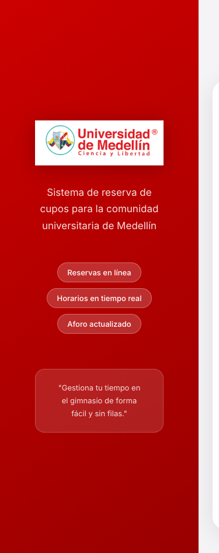 | 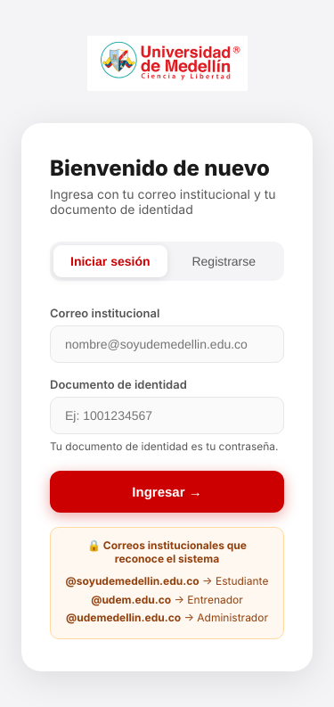 |
| **H-24 · Historial en el celular**: la barra se salía y "Salir" no se veía | 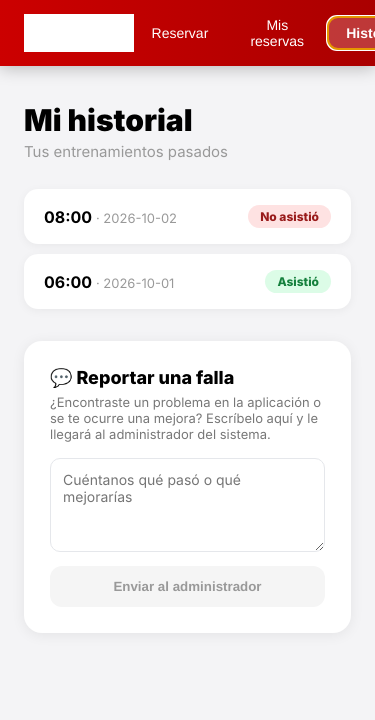 | 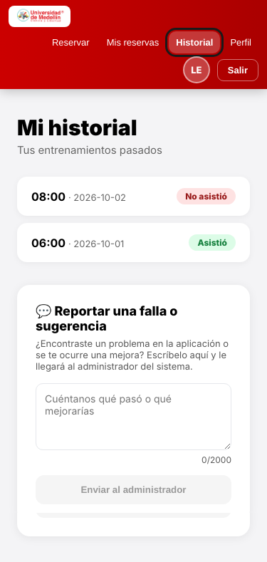 |
| **H-02 · Reserva de mañana**: antes se podía pulsar y el servidor la rechazaba | 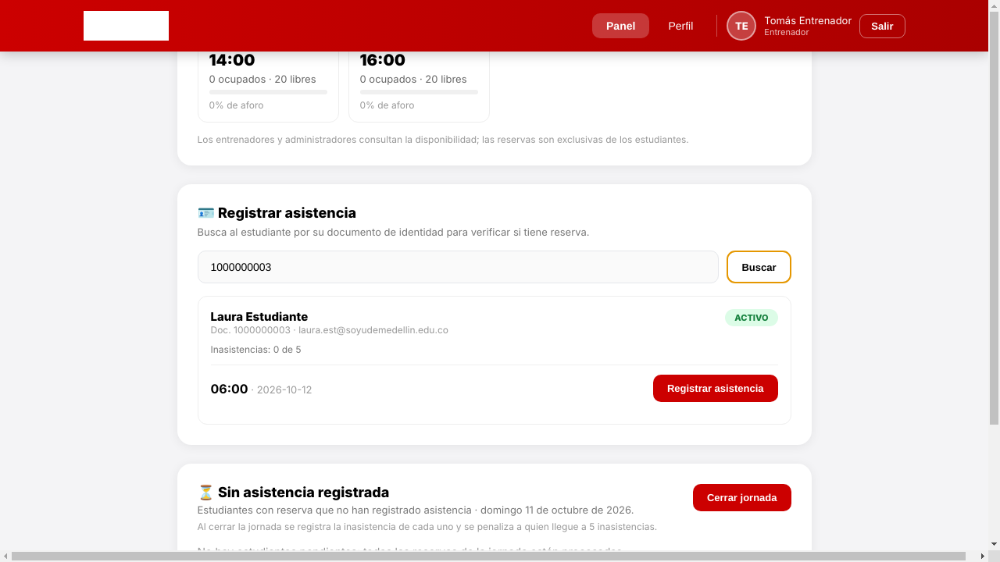 | 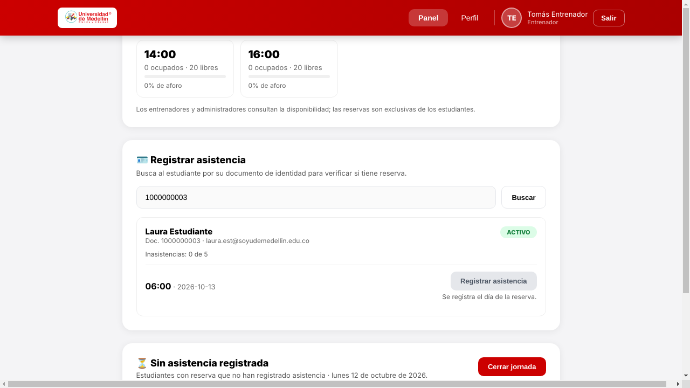 |
| **H-05 · Pendientes cuando falla la consulta** | 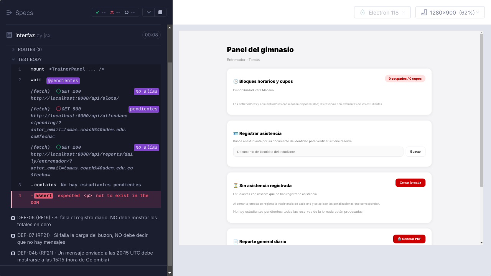 | 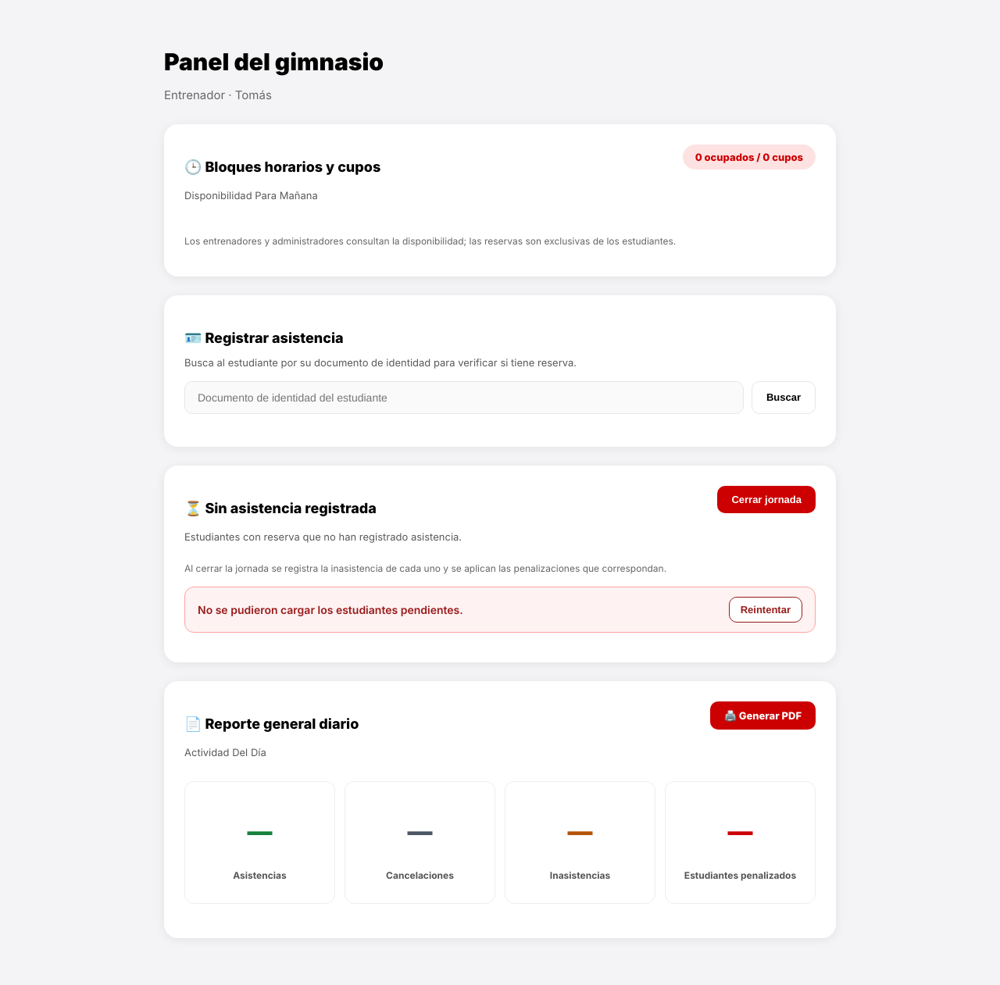 |
| **H-07 · Filtro de pendientes** |  | 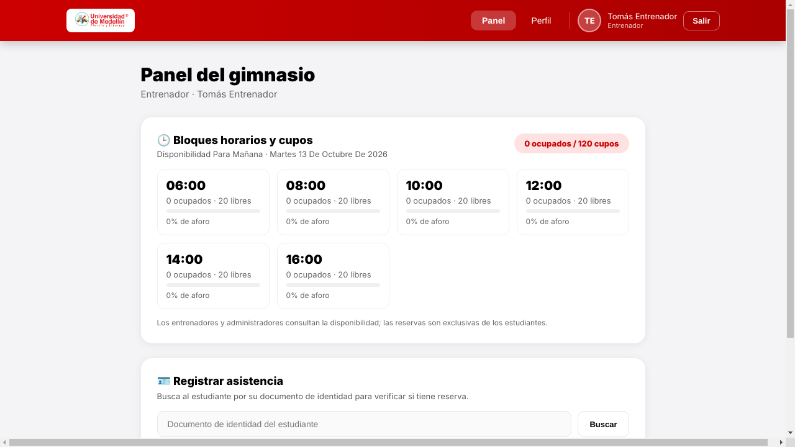 |
| **H-15 / H-16 · Formulario de RF20** | 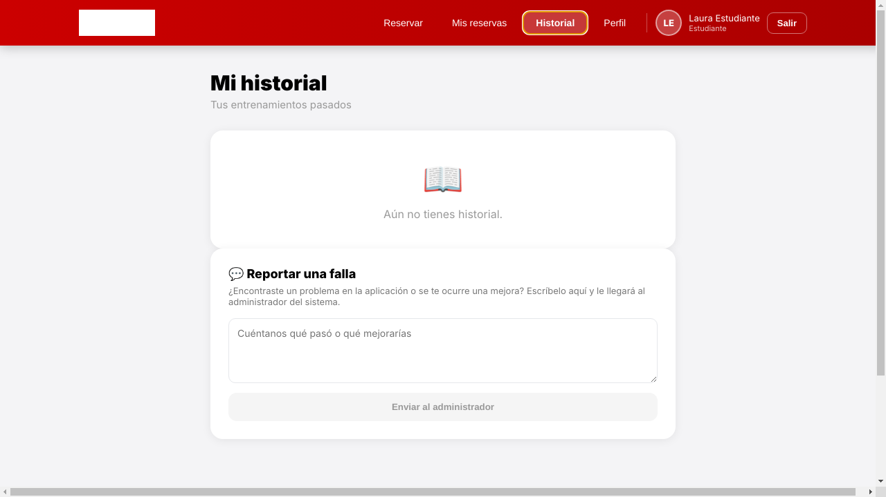 | 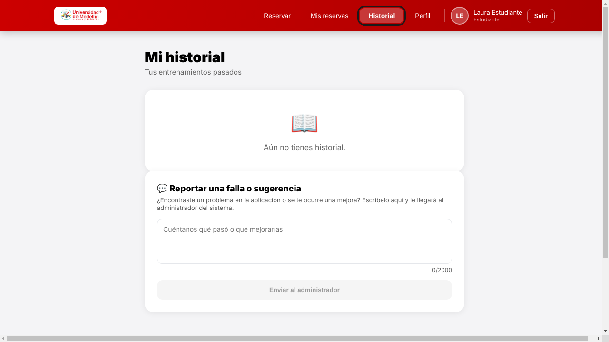 |
| **H-22 · Contraste del panel** | 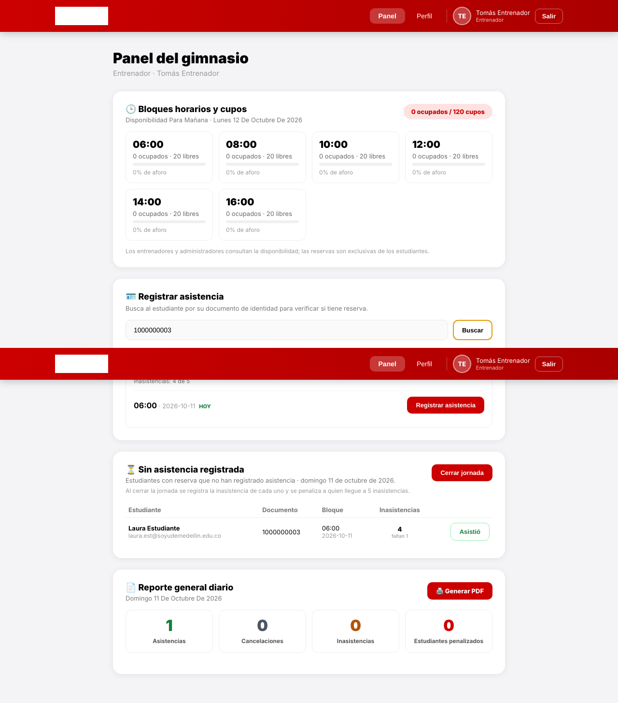 | 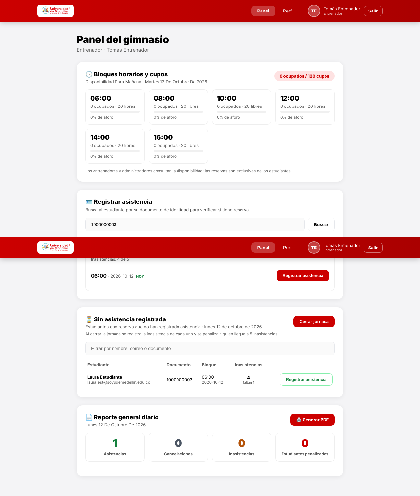 |

---

## 4. Evaluación con usuarios (formulario)

### 4.1 Instrumento y participantes

- **Formulario de Microsoft Forms** con tres secciones:
  - S1: 29 afirmaciones de atributos de usabilidad (eficiencia, eficacia, satisfacción, aprendizaje, memorabilidad, seguridad, flexibilidad, errores y accesibilidad) más 9 de experiencia emocional en escala 1–7.
  - S2: 50 afirmaciones generales de usabilidad.
  - S3: 22 afirmaciones de compromiso del usuario.
- **15 participantes**, del 7 al 11 de octubre de 2026. Se les mostró la aplicación y la usaron libremente antes de responder.
- Las respuestas son **anteriores a las correcciones**: describen la versión original.
- Análisis reproducible en `analisis_formulario.py`; datos en `formulario/respuestas.xlsx` y resultados en `formulario/resultados.json`.

**Calidad de los datos.** La mediana fue de 11,1 minutos para 110 preguntas. Cuatro respuestas (11, 12, 15 y 17) tardaron menos de la mitad, con 1,9 a 2,6 segundos por pregunta. La 11 marcó "5" en todo, incluso en "Me resulta frustrante usar este software".

El equipo confirmó que son personas reales que usaron la aplicación poco tiempo, así que **se incluyen en el análisis**. Como verificación, se repitió el análisis sin ellas: las conclusiones no cambian (columna "Sin las respuestas rápidas").

**Ítems inversos.** El formulario marca la pregunta 26 de S2 ("No necesito leer el manual") como inversa, pero su redacción es positiva, así que no se invirtió.

En las dos inversas reales, 7 de 15 personas estuvieron de acuerdo con "Me resulta frustrante" y 8 con "Me distraigo con elementos innecesarios" (6 con ambas). Todas ellas calificaron la satisfacción con 4 o más, y tres con 5. Lo más probable es que leyeran la negación al revés (sesgo de aquiescencia). Estos dos ítems no se usan para concluir, y se recomienda reformularlos.

### 4.2 Resultados por dimensión

Puntaje 0–100 = (media − 1) / 4 × 100. α de Cronbach mide la consistencia interna de cada dimensión: ≥ 0,7 es aceptable. Con 15 respuestas es solo orientativo.

| Dimensión | Media (1–5) | Puntaje 0–100 | % de acuerdo (4–5) | % en desacuerdo (1–2) | S2 (triangulación) | α | Sin las respuestas rápidas |
|---|---|---|---|---|---|---|---|
| Seguridad | 3,91 | **73** | 73 % | 5 % | — | 0,95 | 74 |
| Flexibilidad | 3,93 | **73** | 71 % | 11 % | 4,15 | 0,87 | 70 |
| Accesibilidad | 3,93 | **73** | 76 % | 18 % | — | 0,96 | 66 |
| Eficacia | 4,36 | 84 | 91 % | 0 % | 4,33 | 0,67 | 83 |
| Memorabilidad | 4,38 | 84 | 98 % | 0 % | 4,53 | 0,91 | 83 |
| Satisfacción | 4,45 | 86 | 93 % | 2 % | 4,12 | 0,75 | 85 |
| Manejo de errores | 4,47 | 87 | 96 % | 0 % | 4,40 | 0,75 | 85 |
| Eficiencia | 4,57 | 89 | 97 % | 0 % | 4,43 | 0,80 | 86 |
| Facilidad de aprendizaje | 4,56 | 89 | 93 % | 0 % | 4,48 | 0,59 | 88 |

Otras medidas:
- **Experiencia emocional:** 5,91 de 7 (82/100).
- **Compromiso (S3):** usabilidad percibida 4,57, estética 4,47, satisfacción y lealtad 4,43, implicación 4,33 y utilidad 4,31.
- **Atención focalizada (S3):** 3,62. Es esperable y no es un problema: es una app de reservas, no de entretenimiento, y lo deseable es entrar, reservar y salir.

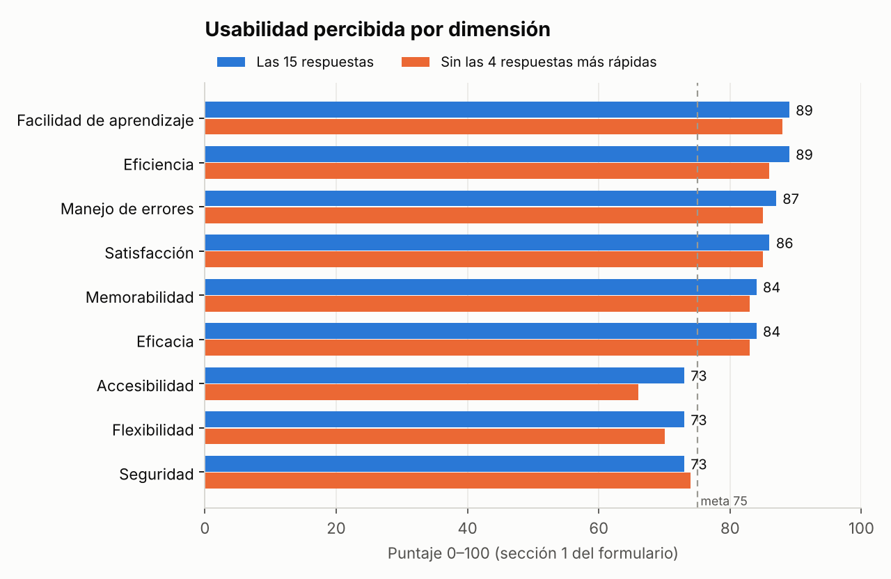

Ítems peor valorados (sin contar los dos inversos de §4.1):

| Ítem | Media | % en desacuerdo |
|---|---|---|
| S1 · 19. Siento confianza en la seguridad del sistema | 3,73 | 7 % |
| S1 · 27. El software es accesible para personas con discapacidades | 3,73 | 27 % |
| S1 · 21. Puedo personalizar el software según mis necesidades | 3,80 | 20 % |
| S1 · 28. El software proporciona opciones de accesibilidad como tamaño de texto y contraste | 3,80 | 20 % |
| S1 · 22. El software se adapta a diferentes dispositivos sin problemas | 3,87 | 7 % |
| S2 · 9. Puedo personalizar el software según mis necesidades | 3,93 | 20 % |

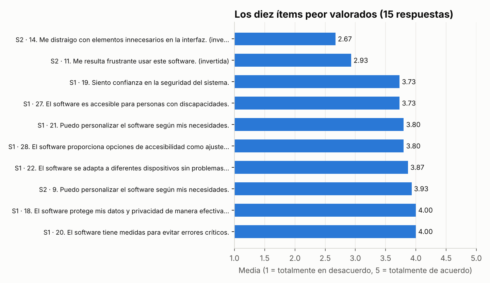

---

## 5. Contraste: IA y herramientas frente a los usuarios

| Dimensión (puntaje de usuarios) | Lo que dicen los usuarios | Lo que encontraron la IA y las herramientas | ¿Coinciden? | Lectura |
|---|---|---|---|---|
| **Accesibilidad (73)** | La más baja junto con Seguridad y Flexibilidad; 27 % en desacuerdo con "es accesible" | axe: 44 elementos con contraste insuficiente (H-22). IA: emojis leídos como texto (H-13), botón Borrar pequeño (H-20). Herramienta: foco casi invisible (H-25) | ✅ Sí | Los usuarios lo percibieron y las herramientas lo localizaron elemento por elemento. Corregido: axe 0 violaciones y Lighthouse 100 |
| **Flexibilidad (73)**: ítem "se adapta a diferentes dispositivos" 3,87 | Personalización y adaptación a dispositivos, por debajo del resto | Herramienta: en el celular el login quedaba fuera de la pantalla (H-23), la barra ocultaba "Salir" (H-24) y faltaba el viewport (H-28). IA: sin filtro de pendientes (H-07) ni selector de fecha (H-12) | ✅ Sí | Los dos problemas de severidad 4 eran de celular. Los usuarios probaron sobre todo en computador, lo que explica que no puntuaran aún más bajo |
| **Seguridad (73)**: "confianza en la seguridad" 3,73 | Empatado con "es accesible" (3,73) como el ítem de S1 peor valorado | Pruebas de seguridad: la API no autentica (VUL-01 a VUL-04). El login anuncia "Tu documento de identidad es tu contraseña" | ✅ Sí | Los usuarios no ven la API, pero sí ven que su contraseña es su cédula: eso basta para desconfiar. Se corrigieron 7 de 11 vulnerabilidades; la autenticación queda propuesta |
| **Manejo de errores (87)** | Alta: "los mensajes de error son claros" | IA: si falla una carga se muestra "no hay datos" (H-05, H-11, H-18). Regresión: se pierde la sesión al recargar (H-26). IA: no se puede deshacer (H-03) | ❌ No | **Discrepancia esperada.** Durante la prueba el servidor no falló, así que los usuarios nunca vieron esos estados. Las pruebas los provocaron simulando fallos. Es un riesgo latente que la encuesta no puede detectar |
| **Facilidad de aprendizaje (89)** | La mejor valorada | IA: el formulario de RF20 está escondido en "Historial" (H-14, severidad 3) | ⚠️ Parcial | Con uso libre nadie tuvo la tarea "reporta una falla". Se recomienda una prueba con tareas (§7) para confirmar H-14 |
| **Eficiencia (89)** | "El tiempo de respuesta es adecuado" 4,47 | k6: con 50 y 100 usuarios, p95 < 170 ms y 0 % de errores | ✅ Sí | Confirmado con mediciones |
| **Satisfacción (86) y emoción (82)** | Altas | Sin contraparte directa | — | — |

**Qué vio cada fuente que las otras no:**

- **La IA leyendo el código** encontró 21 de los 28 hallazgos, sobre todo de interacción y de estados de error (H1, H3, H5, H9). No vio los problemas que solo aparecen al dibujar la página: contraste, celular, viewport y logo.

  También se equivocó una vez. En su primer análisis puso severidad 3 a H-02 porque creía que se podía registrar la asistencia de otro día. Al revisar el backend vio que el servidor sí lo rechaza, y la bajó a 2. Por eso cada hallazgo de la IA se verificó con una prueba antes de darlo por cierto.
- **Las herramientas** (axe, Lighthouse, mediciones de Cypress) encontraron 6 hallazgos, incluidos los dos de severidad 4, con medidas exactas: px de desborde y relación de contraste.
- **Los usuarios** confirmaron qué áreas importan: las tres dimensiones más bajas son justo donde estaban los problemas más graves. No pueden ver problemas latentes, como los estados de error o la falta de autenticación en la API.
- **La suite de regresión** encontró un problema que nadie buscaba: la pérdida de sesión al recargar (H-26) apareció como un fallo intermitente de una prueba.

---

## 6. Accesibilidad e interfaz: mediciones

### 6.1 axe-core, WCAG 2.2 A/AA (`cypress/e2e/ux/accesibilidad.cy.js`)

| Pantalla | Antes | Después |
|---|---|---|
| Login | color-contrast · serio · 3 elementos | 0 |
| Panel del entrenador (RF11, RF12, RF13, RF16) | color-contrast · serio · 23 elementos | 0 |
| Historial y reporte (RF20) | color-contrast · serio · 4 elementos | 0 |
| Buzón del administrador (RF21) | color-contrast · serio · 14 elementos | 0 |

El detalle de cada violación (selector, HTML y relación de contraste) está en `cypress/evidencias/antes/accesibilidad/accesibilidad/*.json`.

### 6.2 Lighthouse, móvil, build de producción (`lighthouse.mjs`)

| Pantalla | Accesibilidad antes → después | Buenas prácticas antes → después | Rendimiento |
|---|---|---|---|
| Login | 91 → **100** | 93 → **100** | 100 |
| Panel del entrenador | 92 → **100** | 93 → **100** | 92–100 |
| Historial y reporte | 91 → **100** | 75 → **100** | — (modo instantánea) |
| Buzón del administrador | 91 → **100** | 75 → **100** | — (modo instantánea) |

Fallas de antes: contraste insuficiente, sin `<meta name="viewport">` y "el documento no usa tamaños de letra legibles" (consecuencia del viewport). Informes HTML completos en `lighthouse/antes/` y `lighthouse/despues/`.

### 6.3 Interfaz en tres tamaños (`cypress/e2e/ux/interfaz.cy.js`)

Para cada pantalla y tamaño, la prueba verifica tres cosas: que no haya desplazamiento horizontal, que los controles midan al menos 24 × 24 px (WCAG 2.5.8) y que el foco sea visible en los campos.

| Pantalla | Celular 375 px antes → después | Tableta 768 px | Escritorio 1280 px | Campos con foco insuficiente |
|---|---|---|---|---|
| Login | **261 px** de desborde → 0 | 0 → 0 | 0 → 0 | 2 → 0 |
| Panel del entrenador | **159 px** → 0 | 0 → 0 | 0 → 0 | 1 → 0 |
| Historial y reporte | **363 px** → 0 | 0 → 0 | 0 → 0 | 0 → 0 |
| Buzón del administrador | **269 px** → 0 | 0 → 0 | 0 → 0 | 3 → 0 |

Ningún control mide menos de 24 × 24 px. Queda un texto de 10 px ("faltan N" en la tabla de pendientes) que conviene subir a 12 px.

---

## 7. Correcciones realizadas

| Corrección | Archivo | Hallazgos |
|---|---|---|
| Panel decorativo del login oculto en pantallas ≤ 768 px; barra de navegación que se reacomoda en ≤ 640 px; foco visible | `frontend/src/App.jsx`, `Navbar.jsx` | H-23, H-24, H-25 |
| `<meta name="viewport">`, `theme-color` y descripción | `frontend/index.html` | H-28 |
| 51 colores de texto oscurecidos para cumplir 4,5:1 | componentes | H-22 |
| La sesión solo se cierra si la cuenta ya no existe (404/403); los errores de la API llevan su código HTTP | `App.jsx`, `services/api.js` | H-26 |
| Estados de error con "Reintentar" en pendientes, registro diario y buzón; "Cerrar jornada" no actúa si no se pudo consultar | `TrainerPanel.jsx`, `AdminPanel.jsx` | H-05, H-11, H-18 |
| Búsqueda con "Buscando…", validación del documento, botón deshabilitado para reservas de otro día, filtro de pendientes, nombre único "Registrar asistencia" y confirmación de cierre con afectados, penalizados y aviso de horario | `TrainerPanel.jsx` | H-01, H-02, H-04, H-06, H-07, H-08, H-10 |
| Hora del buzón en zona de Colombia; botón Borrar más grande y descrito | `AdminPanel.jsx` | H-17, H-20 |
| Título "falla o sugerencia" y contador de caracteres | `HistoryView.jsx` | H-15, H-16 |
| Emojis decorativos con `aria-hidden` y logo visible | componentes, `Navbar.jsx` | H-13, H-27 |

**Regresión después de corregir:**

| Suite | Resultado |
|---|---|
| Django (incluye las de Violeta) | 149: 143 pasan y 6 son hallazgos pendientes marcados como fallo esperado |
| Vitest | 85 de 85 |
| Cypress de regresión (API, E2E y componentes) | 101 de 101 |
| Controles de seguridad | 8 de 8 |
| Hallazgos, accesibilidad e interfaz | todas pasan |

Las salidas de Django y Vitest están en [`../resultados-unitarias/`](../resultados-unitarias/).

Se actualizaron **8 pruebas de caja blanca** de `camila.test.jsx`. Sus caminos cambiaron a propósito: los de error ahora muestran el aviso en vez del estado vacío, y el botón "Asistió" ahora se llama "Registrar asistencia". Cada una tiene un comentario que lo explica.

Hay que actualizar también los diagramas `front_RF11_registrarAsistencia`, `front_RF12_pendientes`, `front_RF16_registroDiario` y `front_RF21_cargarBuzon.drawio`, y la tabla de caminos de `caja-blanca-camila.docx`.

> ⚠️ **Para las pruebas de Katalon del equipo.** Si algún localizador usa estos textos, hay que actualizarlo:
> - el botón de la tabla de pendientes ahora dice **"Registrar asistencia"** (antes "Asistió");
> - el título del formulario ahora es **"Reportar una falla o sugerencia"**;
> - el botón de búsqueda dice "Buscando…" mientras espera respuesta;
> - una reserva de otro día muestra el botón **deshabilitado**;
> - el diálogo de "Cerrar jornada" tiene un texto más largo, pero empieza igual ("Se marcarán N inasistencias…").

### Pendientes y siguientes pasos

1. **H-14:** dar al formulario de RF20 un acceso propio en la barra, y confirmarlo con una **prueba de usuarios con tareas**, por ejemplo "reporta que el botón X no funciona", midiendo tiempo y tasa de éxito.
2. **H-03 y H-19:** anular una asistencia durante unos minutos y estados "Atendido/Archivado" en el buzón. Requieren cambios en la API.
3. **H-12, H-09 y H-21:** selector de fecha en el registro diario, modal propio y paginación del buzón.
4. **Volver a aplicar el formulario** con la versión corregida, sobre todo en celular, para medir el cambio en Accesibilidad y Flexibilidad. Antes, reformular los dos ítems inversos y corregir la marca de "inversa" de la pregunta 26.

---

## 8. Reproducir

```bash
cd frontend
npm run cy:hallazgos        # hallazgos heurísticos verificables
npm run cy:accesibilidad    # axe-core por pantalla
npm run cy:interfaz         # celular, tableta y escritorio, y foco

# Lighthouse sobre el build de producción
VITE_API_URL=http://localhost:8000/api npx vite build --outDir /tmp/dist
npx vite preview --outDir /tmp/dist --port 4173 &
CHROME_PATH=/ruta/a/chrome node ../regression_testing/ux/lighthouse.mjs mi-ejecucion

# Formulario: reemplazar formulario/respuestas.xlsx por la exportación de Forms
python ../regression_testing/ux/analisis_formulario.py
```
